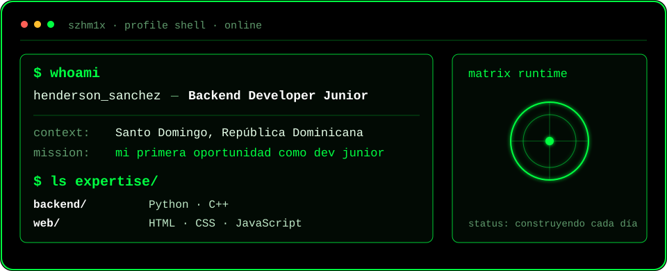
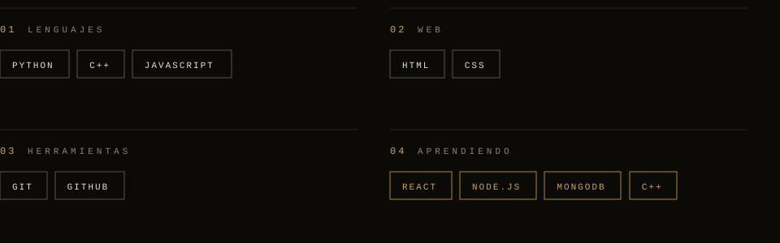

<div align="center">

<!-- BANNER -->
<a href="https://github.com/szhm1x">
  
</a>

<br>

<a href="https://github.com/szhm1x">
  
</a>


</div>

---

## `$ whoami`

<p align="center">
  
</p>

---

## `$ cat tech-stack.yaml`

<p align="center">
  
</p>

---

## `$ ls ~/projects`

<p align="center">
  
</p>

<p align="center"><sub><a href="https://szhm1x.github.io/"><code>szhm1x.github.io</code></a></sub></p>

---

## `$ cat education.log`

```log
[2026-2029]  Ingeniería de Software ........... Universidad APEC (UNAPEC)
[cert]       Full Stack Web Development ....... INDOTEL
[cert]       Full Stack Developer Expert ...... CertiPlus
[tecnico]    Bachillerato Técnico en Electricidad ... Politécnico Madre Rafaela Ybarra
```

---

## `$ git log --stats`

<div align="center">


</div>

---

## `$ connect --socials`

<div align="center">

<a href="https://www.linkedin.com/in/hendersonsanchez/"></a>&nbsp;&nbsp;<a href="https://szhm1x.github.io/"></a>&nbsp;&nbsp;<a href="mailto:Hendersonsanchez588@gmail.com"></a>&nbsp;&nbsp;<a href="https://github.com/szhm1x"></a>

</div>
