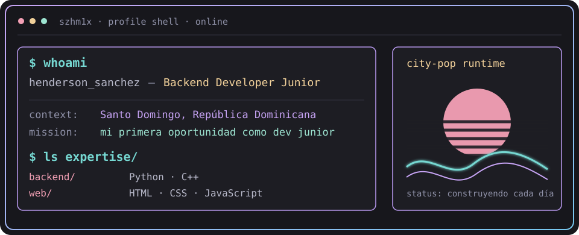

<div align="center">

<!-- BANNER -->
<a href="https://github.com/szhm1x">
  <picture>
    <source media="(prefers-color-scheme: dark)" srcset="assets/banner-dark.svg">
    <source media="(prefers-color-scheme: light)" srcset="assets/banner-light.svg">
    
  </picture>
</a>

<br>

<a href="https://github.com/szhm1x">
  
</a>


</div>

---

## `$ whoami`

<p align="center">
  
</p>

<br>

<div align="center">

## `$ cat tech-stack.yaml`

<table border="1" cellpadding="14" bgcolor="#17171c">
  <thead>
    <tr>
      <th colspan="2" align="left"><code>szhm1x:~$ cat tech-stack.yaml</code></th>
    </tr>
  </thead>
  <tbody>
    <tr>
      <td width="50%" valign="top"><code>├─ ✦ languages:</code><br><br>
        <br>
        <sub><code>Python · C++ · JavaScript</code></sub>
      </td>
      <td width="50%" valign="top"><code>├─ ◉ web_basics:</code><br><br>
        <br>
        <sub><code>HTML · CSS</code></sub>
      </td>
    </tr>
    <tr>
      <td valign="top"><code>├─ ⚙ tooling:</code><br><br>
        <br>
        <sub><code>Git · GitHub</code></sub>
      </td>
      <td valign="top"><code>╰─ ⌁ in_progress (aprendiendo):</code><br><br>
        <br>
        <sub><code>React · Node.js · MongoDB · C++</code></sub>
      </td>
    </tr>
  </tbody>
  <tfoot>
    <tr>
      <td colspan="2"><code>status: learning&nbsp;&nbsp;·&nbsp;&nbsp;environment: development</code></td>
    </tr>
  </tfoot>
</table>

</div>

---

## `$ ls ~/projects`

<div align="center">

<table border="1" cellpadding="14" bgcolor="#17171c">
  <thead>
    <tr>
      <th colspan="3" align="left"><code>szhm1x:~$ ls -la ~/projects</code></th>
    </tr>
  </thead>
  <tbody>
    <tr>
      <td valign="top" width="33%"><code>├─ 🛒 ministore/</code><br><br>Tienda en <b>Python</b> con arquitectura modular y datos en <b>JSON</b>.<br><br><sub><code>Python · JSON</code></sub></td>
      <td valign="top" width="34%"><code>├─ 👗 rovelle/</code><br><br>E-commerce en equipo para <b>Diseño Web</b> (UNAPEC): landing, login y carrito. <b>Rol: backend.</b><br><br><sub><code>Backend · Equipo</code></sub></td>
      <td valign="top" width="33%"><code>╰─ 🌐 portafolio/</code><br><br>Mi perfil, habilidades y proyectos en un solo sitio.<br><br><sub><a href="https://szhm1x.github.io/"><code>szhm1x.github.io</code></a></sub></td>
    </tr>
  </tbody>
</table>

</div>

---

## `$ cat education.log`

```log
[2026-2029]  Ingeniería de Software ........... Universidad APEC (UNAPEC)
[cert]       Full Stack Web Development ....... INDOTEL
[cert]       Full Stack Developer Expert ...... CertiPlus
[tecnico]    Bachillerato Técnico en Electricidad ... Politécnico Madre Rafaela Ybarra
```

---

## `$ git log --stats`

<div align="center">


<br>


</div>

---

<!-- CONTACTO -->
## `$ connect --socials`

<div align="center">

<a href="https://www.linkedin.com/in/hendersonsanchez/">
  
</a>&nbsp;&nbsp;
<a href="https://szhm1x.github.io/">
  
</a>&nbsp;&nbsp;
<a href="mailto:Hendersonsanchez588@gmail.com">
  
</a>&nbsp;&nbsp;
<a href="https://github.com/szhm1x">
  
</a>

</div>

<br>
<br>

<div align="center">
<sub>Hecho con 💜 desde Santo Domingo, República Dominicana · @szhm1x</sub>
</div>
